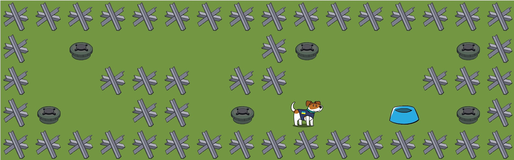

## 2d game Patron Dog

[Patron the Dog](https://en.wikipedia.org/wiki/Patron_(dog)) is a Jack Russell Terrier and the famous detection dog mascot of Ukraine’s State Emergency Service. In this top-down 2D game, you guide Patron through a minefield to detect every PMN landmine. Once all mines are found, the bowl is filled with food and the game is won.

This project is written in C and built using custom C libraries, along with [MiniLibX library](#what-minilibx-is) for the graphical interface and gameplay rendering.



## To compile

Check dependency setup:

```bash
# Build the project
make
# Check dependency setup
make -n deps
# Install dependency
make deps
```

## To  run a game

```bash
./so_long maps/map.ber
# Put another name of the map to play on the different map
./so_long maps/[name].ber
```

## To stop the game

Press the ESC key, or close the window using the X button.

## Prerequisites

This project is built for Linux with X11 support, using MiniLibX.

- OS: Linux (Ubuntu/Debian-based distributions are the expected target)
- Required tools: `gcc`, `make`, `git`
- Required X11 development packages:
  - `xorg`
  - `libxext-dev`
  - `libbsd-dev`
- An X server must be available when running the game

On Debian/Ubuntu, install them with:

```bash
sudo apt-get update
sudo apt-get install -y gcc make git xorg libxext-dev libbsd-dev
```

For macOS, MiniLibX usually requires XQuartz.

## Cleanup

```bash
# removes object files
make clean
# removes object files and executable files
make fclean
```

If you want to remove the X11 development packages later, use `apt` to uninstall them cleanly:

```bash
sudo apt-get remove --purge xorg libxext-dev libbsd-dev
sudo apt-get autoremove
```

This is the safer approach because `apt` will automatically clean up orphaned dependencies that were installed only for these packages.

## What MiniLibX is

MiniLibX is a very small C graphics library for Unix systems. It's as a simple X-Window (X11R6) programming API that gives you window creation and basic drawing tools without needing a big engine like SDL, SFML, or OpenGL.

In other words: it creates a window, it handles events (keyboard, mouse, close), it lets you draw pixels or images and it runs an event loop.

## Credits

Special thanks to the author of the original dog sprite that inspired this project.

Personal thanks to Oleksii Novokhatskyi: [GitHub](https://github.com/novokhatskyioleksii)

You can also check the online game here: [Sniffer Dog Quest](https://sniffer-dog-quest.web.app/)

Related project: [patron-deminer](https://github.com/marynakharchenko/patron-deminer)